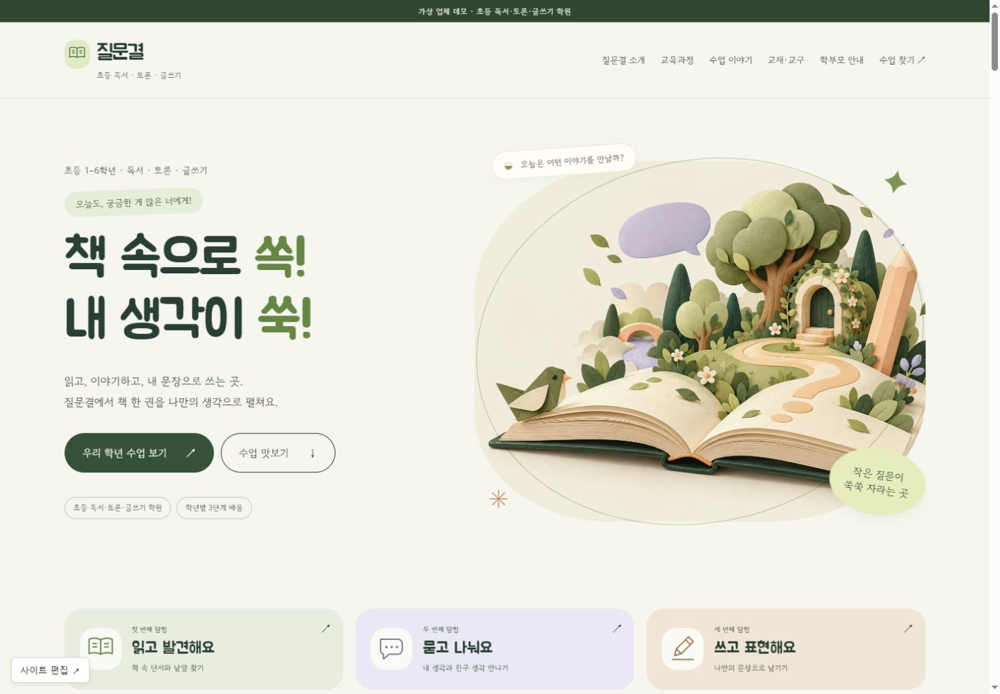

# 질문결 Orbit 화면 모듈

선택 디자인: 아이보리·올리브, Gowun Dodum+Manrope, 곡선 교실 사진.
헤더·히어로·과정·수업·교재·과정찾기·푸터는 library/config.json에 등록.
콘텐츠 원본: templates/edu-academy/orbit/src/data/site.json
스타일 원본: templates/edu-academy/orbit/src/app/globals.css
다른 앱에서 소스를 import하거나 복사하지 말고 표현만 참고한다.

1.1: Jua 제목·종이 공예 일러스트 3종·수업 탐험 탭. 추가 스타일 src/app/kids.css. 이미지 기획 docs/image-plan.md.
